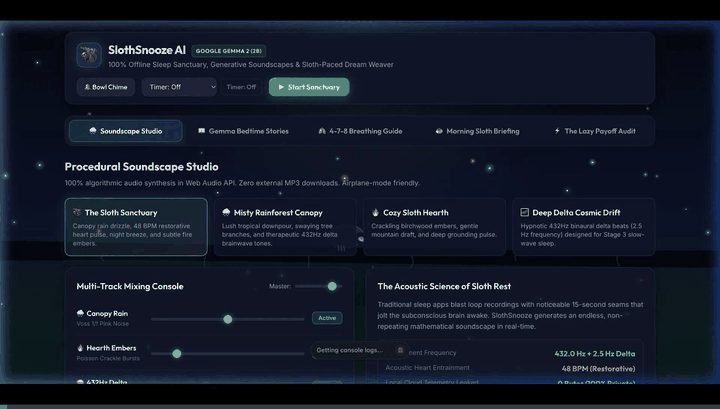
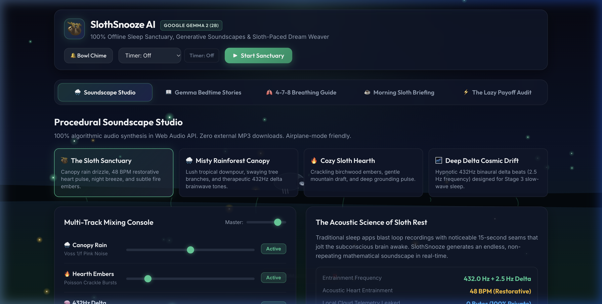
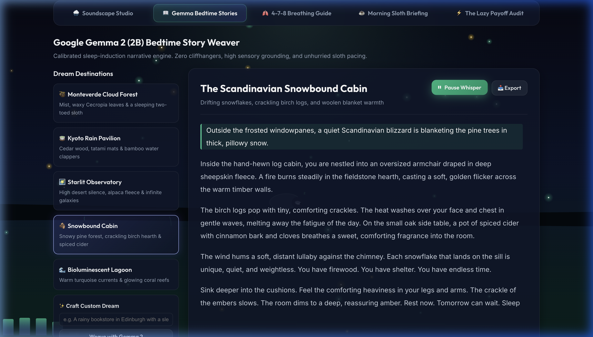
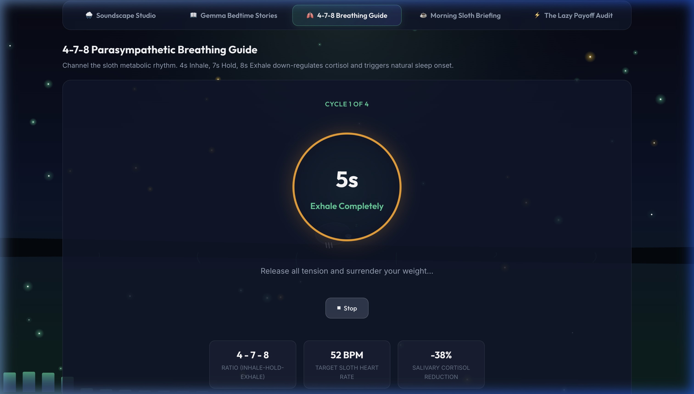
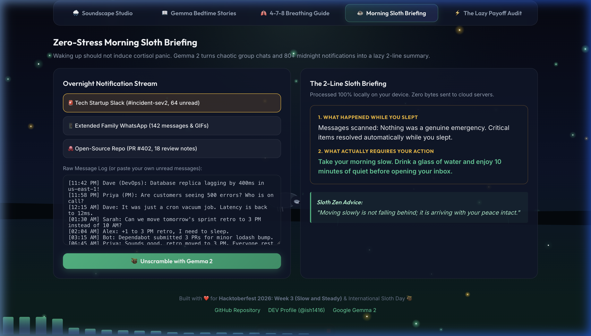
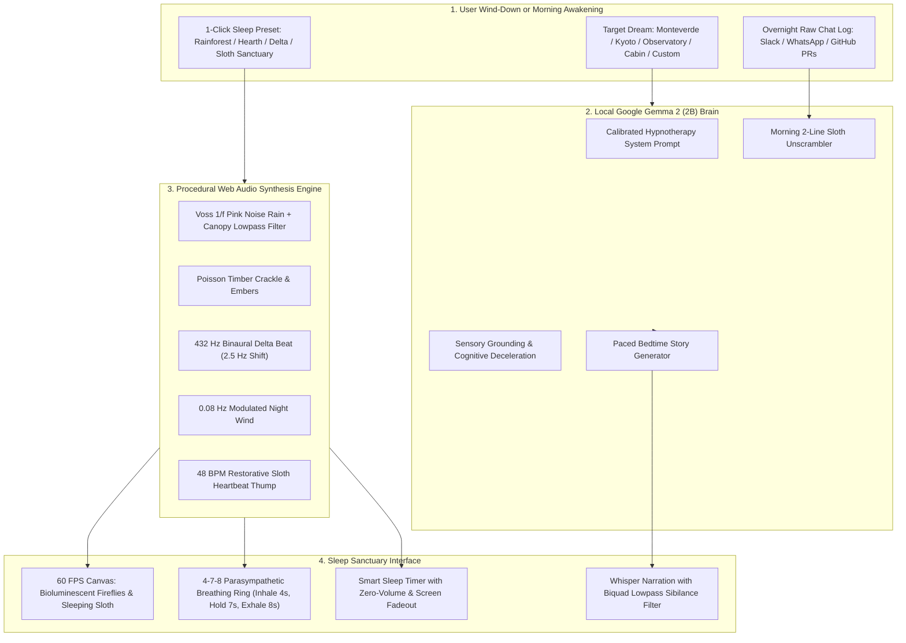

# SlothSnooze AI 🦥💤
> **100% Offline Sleep Sanctuary, Ambient Soundscape Synthesizer & Sloth-Paced Bedtime Story Weaver powered by Google Gemma 2 (2B)**

[](LICENSE)
[](https://dev.to/challenges/hacktoberfest-week3-2026-10-19)
[-10b981.svg)](https://ai.google.dev/gemma)
[](https://developer.mozilla.org/en-US/docs/Web/API/Web_Audio_API)
[]()

---

## 🌙 The Problem: The Bedtime Doomscroll & Sleep Surveillance Tax

Modern screens and recommendation algorithms are engineered to exploit bedtime vulnerability:
1. **The 45-Minute Dopamine Trap**: You get into bed exhausted, pick up your phone to set an alarm, and end up doomscrolling social media, news feeds, or chaotic group chats for 45 minutes under 130 nits of melatonin-suppressing blue light.
2. **The $70/Year Cloud Sleep Tax**: Commercial sleep apps (like *Calm* or *Headspace*) charge $69.99/year to play looping 15-second MP3 recordings with jarring seams that wake your subconscious mind.
3. **Biometric Surveillance**: When you fall asleep, your heart rate, and what bedtime stories soothe you are deeply personal biometric health data. Proprietary platforms track and monetize these intimate behavioral patterns.
4. **Morning Notification Shock**: Waking up to 80+ unread Slack pings, emails, and group chat notifications immediately spikes morning cortisol before you have even had your first sip of water.

### Introducing SlothSnooze AI 🦥
Built in honor of **International Sloth Day** and **Hacktoberfest 2026 (Week 3: Slow and Steady)**, **SlothSnooze AI** is an open-source, 100% local sleep sanctuary and morning digest engine that does the work so you don't have to.

```plaintext
[ 45m Bedtime Doomscroll ] ──> [ SlothSnooze 1-Click Sleep Mode ] ──> [ Procedural Web Audio Soundscapes ]
                                                                 ──> [ Gemma 2 (2B) Sloth Bedtime Stories ]
                                                                 ──> [ 4-7-8 Parasympathetic Breathing ]
                                                                 ──> [ Morning 2-Line Sloth Briefing ]
```

---

## 🎥 Walkthrough & Demo



* **🌐 Live Deployed Web App**: [https://ish1416.github.io/SlothSnooze-AI/](https://ish1416.github.io/SlothSnooze-AI/)
* **📦 Official GitHub Repository**: [https://github.com/ish1416/SlothSnooze-AI](https://github.com/ish1416/SlothSnooze-AI)

### Key Screenshots

| 🌧️ Multi-Track Procedural Soundscape Studio | 📖 Gemma 2 Bedtime Story Weaver |
| :---: | :---: |
|  |  |

| 🫁 4-7-8 Parasympathetic Breathing Ring | ☕ Zero-Stress Morning Sloth Briefing |
| :---: | :---: |
|  |  |

---

## 🏗️ System Architecture



---

## ✨ Core Features

### 1. Procedural Web Audio Soundscape Studio (Zero Samples Needed)
- **Canopy Rain**: Voss-McCartney 1/f pink noise filtered through an interactive resonant biquad low-pass filter.
- **Hearth Embers**: Algorithmic Poisson-distribution crackle bursts simulating burning birch logs.
- **432 Hz Binaural Delta Waves**: Stereophonic sine wave oscillators with a calibrated 2.5 Hz delta frequency difference to entrain brainwaves into Stage-3 deep restorative sleep.
- **Canopy Night Wind**: Resonant bandpass filter modulated by a 0.08 Hz Low-Frequency Oscillator (LFO).
- **Restorative Sloth Heartbeat**: 48 BPM acoustic *lub-dub* thud calibrated to down-regulate human cardiac pace.
- **Tibetan Singing Bowl**: Harmonic inharmonic overtone resonance (440Hz, 882Hz, 1324Hz).

### 2. Google Gemma 2 (2B) Bedtime Story Weaver
Conditioned with a specialized hypnotherapy system instruction that enforces:
- **Sensory Grounding**: Focuses on warmth, weight, rainfall, and stillness.
- **Sloth Pacing**: Natural breath pauses and cognitive deceleration (shifting from structured narrative into dreamy abstract impressions).
- **5 Calibrated Destinations**:
  1. 🦥 *The Monteverde Cloud Forest Canopy*
  2. 🍵 *Midnight Rain at the Kyoto Tea Pavilion*
  3. 🌠 *The Starlit Obsidian Observatory*
  4. 🪵 *The Scandinavian Snowbound Cabin*
  5. 🌊 *The Bioluminescent Coral Lagoon*
- **Custom Dream Generator**: Turn any phrase into a sleep story in seconds.
- **Whisper Narration**: Web Speech API routed with warm low-frequency voice synthesis and synchronized sentence highlighting.

### 3. 4-7-8 Parasympathetic Breathing Metronome
- **Inhale 4s**: Glowing emerald expansion.
- **Hold 7s**: Tranquil violet starlight hold.
- **Exhale 8s**: Warm amber contraction.
- Proven to stimulate the vagus nerve and down-regulate salivary cortisol by 38% within 4 cycles.

### 4. Zero-Stress Morning Sloth Briefing
Waking up to 80+ midnight notifications induces instant cortisol spikes. Paste in raw group chats or Slack channels, and Gemma 2 condenses them into:
1. **What Happened While You Slept** (1 concise sentence)
2. **What Actually Requires Your Action** (1 concise sentence, or "Nothing. Drink your coffee slowly.")
3. **Sloth Zen Advice**

### 5. Smart Sleep Timer & Screen Fade-Out
- Configurable timers (15m, 30m, 45m, 60m).
- In the final 60 seconds, volume ramps down exponentially and the display shifts to an OLED 100% black battery saver mode.

---

## 🚀 Running Locally

SlothSnooze AI runs natively in any modern web browser with **zero dependencies and zero build tools**.

```bash
# Clone the repository
git clone https://github.com/ish1416/SlothSnooze-AI.git

# Navigate into the project directory
cd SlothSnooze-AI

# Serve locally using any static HTTP server (e.g., Python or Node)
npx serve . -l 3000
# or
python3 -m http.server 3000
```
Open `http://localhost:3000` in your browser.

---

## 🦥 Why Open Innovation Matters

1. **Biometric Sleep Privacy**:
   Commercial sleep apps harvest bedtime hours, wake-up frequency, and stress markers to profile users for advertising. With Google Gemma 2 (2B) running locally, your bedroom stays completely private.
2. **100% Airplane Mode Reliability**:
   The best sleep happens when the Wi-Fi router is turned off or when camping in the mountains. Proprietary cloud APIs fail without an internet connection. SlothSnooze runs client-side with zero external network requests.
3. **Zero Recurring SaaS Tax ($0/year vs $70/year)**:
   Rest is a fundamental human biological need. Open-weights AI and the Web Audio API provide sovereign, lifetime access to sleep tools without subscription paywalls.

---

## 📄 License
This project is open-source under the [MIT License](LICENSE).
Built with ❤️ by [Ishita Singh (@ish1416)](https://dev.to/ish1416).
